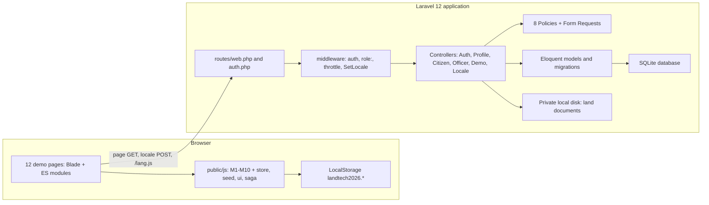
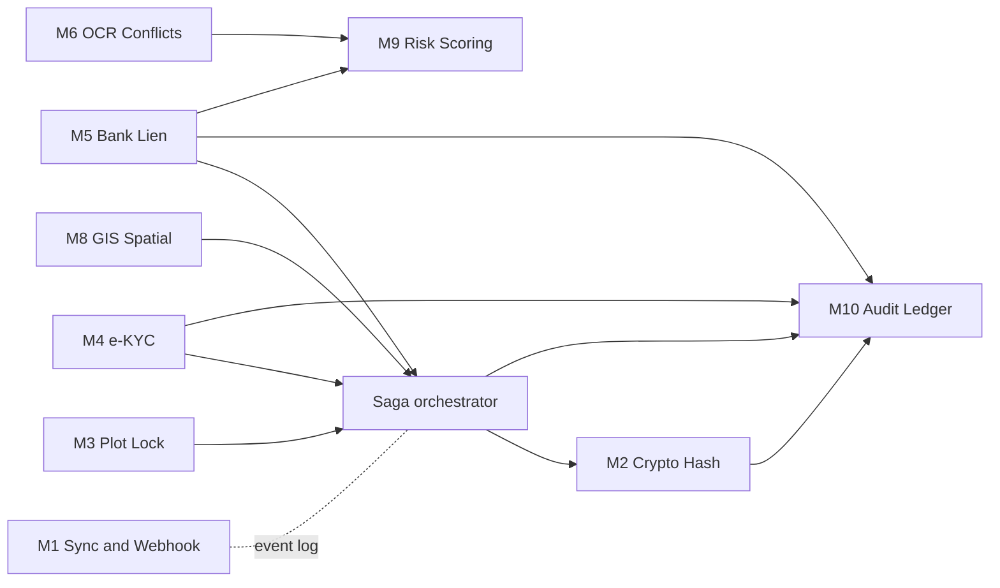
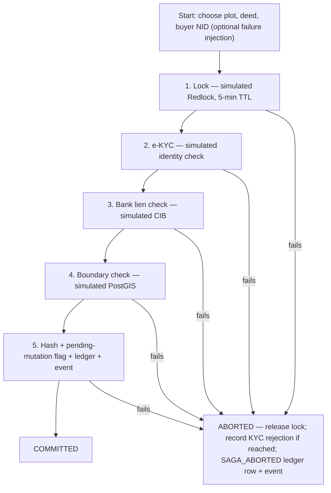

# LandTech 2026 — Fraud & Multiple-Sale Detection for Land Transactions

**Problem statement P3 · a two-layer prototype for Bangladesh: a real, tested Laravel
application + a browser-side demonstration of ten fraud-detection modules.**

LandTech 2026 explores one question: *how could a land-transaction system catch forged
deeds, double sales, rapid resale chains and registration-vs-mutation mismatches before
the transaction completes — while keeping an auditable trail of every step?*

> **Honest scope — read this before anything else.**
>
> - The **public module pages** (M1–M10: `/dashboard`, `/saga`, `/crypto-verify`, …) are a
>   **browser-side simulation**. Every "external" system they portray — government
>   registries, Porichoy e-KYC, bank/CIB lien checks, Redis locking, OCR/AI, PostGIS,
>   blockchain — is **simulated with synthetic data** in the browser's LocalStorage.
>   No external system is contacted anywhere in this repository.
> - The **role-based panels** (`/citizen/*`, `/admin/*`, `/registry/*`, `/bank/*`) are a
>   **real Laravel application**: server-side authentication, four roles, policies,
>   database-backed workflows and a 242-test suite. But no government, e-KYC, bank or
>   GIS integration is connected, and reviewer workflows (officer approval, listing
>   publication, record verification) are **not implemented yet** — they are documented
>   as incomplete throughout this file.
> - As built, this prototype **does not prevent real-world fraud**. Its detection logic
>   is rule-based, its demo data is fictional, and its value is the demonstrated
>   workflow and working backend core.

## Table of Contents

1. [Project Overview](#1-project-overview)
2. [Problem and Proposed Solution](#2-problem-and-proposed-solution)
3. [Project Capabilities at a Glance](#3-project-capabilities-at-a-glance)
4. [System Architecture](#4-system-architecture)
5. [The Ten Modules (M1–M10)](#5-the-ten-modules-m1m10)
6. [End-to-End Workflow](#6-end-to-end-workflow)
7. [Practical Demo Scenarios](#7-practical-demo-scenarios)
8. [Technology Stack and Project Structure](#8-technology-stack-and-project-structure)
9. [Installation and Execution](#9-installation-and-execution)
10. [Security, Limitations, and Integration Status](#10-security-limitations-and-integration-status)
11. [Future Roadmap](#11-future-roadmap)

---

## 1. Project Overview

### What LandTech 2026 is

A prototype for the P3 challenge: a system that helps detect land-transaction fraud in
Bangladesh. It has two independent layers that run from the same Laravel application:

1. **A real application layer** — user accounts, four roles (`admin`,
   `registry_officer`, `bank_officer`, `citizen`), and citizen workflows for land
   records, documents, sale listings, ownership claims, buyer search and verification
   requests. This layer uses a database, enforces authorization with middleware and
   policies, encrypts NID values, and is covered by an automated test suite.
2. **A public demonstration layer** — twelve pages that simulate the intended
   production system through ten fraud-detection modules (M1–M10): event
   synchronization, cryptographic deed hashing, plot locking, e-KYC, lien checks,
   rule-based conflict detection, inheritance-share math, GIS overlap checks, risk
   scoring, a hash-chained audit ledger, and a Saga orchestrator with compensation.

The two layers **do not share data**. The demo pages store everything in the browser's
LocalStorage; the application stores everything in SQLite. Resetting the demo never
touches the database.

### The problem

Land fraud in Bangladesh often exploits a structural gap: **registration** (sub-registry
offices) and **mutation** (land office ownership records) live in separate systems, and
verification depends on manual cross-checking. Common fraud patterns:

- **Forged or altered deed documents** presented as originals.
- **The same plot sold to multiple buyers**, each holding a genuine-looking deed.
- **Rapid resale chains** that move ownership implausibly fast.
- **Registered but unmutated deeds** — the deed exists, the ownership record does not.

By the time a buyer discovers the problem, the seller is gone and the paper trail is
hard to reconstruct.

### What the prototype demonstrates today

| Area | Demonstrated by | Nature |
|---|---|---|
| Tamper detection for deed documents | M2 (SHA-256 hashing) | Real hashing, synthetic records |
| Multiple-sale and rapid-transfer detection | M6 rule engine, M9 scoring | Rule-based, synthetic data |
| Transaction locking and conflict refusal | M3, Saga step 1 | Simulated lock (no Redis) |
| Identity verification flow | M4, Saga step 2 | Simulated e-KYC, real local camera |
| Encumbrance blocking | M5, Saga step 3 | Simulated liens / e-NOC |
| Inheritance-share validation | M7 | Real arithmetic, client-side |
| Spatial conflict check | M8, Saga step 4 | Real map tiles, synthetic polygons |
| Composite risk score per plot | M9 | Rule-based, transparent weights |
| Tamper-evident audit trail | M10 | Real SHA-256 chain, browser-only |
| Ordered transaction flow with rollback | Saga orchestrator | Real orchestration logic |
| Secure backend core | Laravel app | Real, tested (auth, roles, policies) |

### Who would benefit

- **Citizens and buyers** — a "check before you buy" risk report and verified flows.
- **Sub-registry and land offices** — conflict detection they currently do by hand.
- **Banks** — lien visibility before collateral changes hands.
- **Policymakers** — a worked design for connecting registration and mutation systems.

### Value proposition

The project is not a slide deck. The detection rules are **runnable and inspectable**,
the transaction flow executes with real compensation logic, the cryptographic checks
use real SHA-256, and the backend access-control core is implemented and tested.
It shows what "traceable land transactions" could concretely look like — and documents
precisely where the simulation ends and real integration would have to begin
(see [§10](#10-security-limitations-and-integration-status)).

---

## 2. Problem and Proposed Solution

Each fraud pattern is mapped to the detection or verification approach the prototype
implements, the responsible module, and the result the demo actually produces.

| Land-related problem | Proposed approach | Module | Result demonstrated by the prototype |
|---|---|---|---|
| Forged / altered deed copies | SHA-256 hash of the deed's canonical data; re-hash and compare | M2 | A simulated forgery is detected, both hashes are shown, `DEED_TAMPER_DETECTED` is written to the ledger |
| Same plot sold to multiple buyers | Group deeds per plot; more than one deed raises a CRITICAL conflict and a score weight | M6, M9 | Seeded `P-103` (2 deeds) is flagged CRITICAL; plot scores jump by +40 |
| Implausible rapid resale chain | Compare successive registration dates per plot; gaps under 30 days raise HIGH conflicts | M6, M9 | Seeded `P-107` (3 deeds, 1/4/7 days old) produces two rapid-transfer findings |
| Registration ↔ mutation mismatch | Flag plots marked `PENDING_MUTATION` that already have registered deeds | M6, M9 | MEDIUM findings for affected plots; +20 to their risk score |
| Selling mortgaged / encumbered land | Active-lien check returns a block reason; sale flow refuses to continue | M5, Saga | `P-109`'s seeded lien aborts the Saga at step 3 until an e-NOC is issued |
| Identity impersonation | NID format validation plus probabilistic face-match/liveness signals | M4, Saga | Rejected or malformed KYC aborts the transfer flow |
| Two simultaneous transfers on one plot | Time-limited lock with holder token; second acquisition refused | M3, Saga | A second acquire on a locked plot is refused; Saga aborts on a locked plot |
| Over-transfer of inheritance shares | Shares must sum to 1.0; a transfer may not exceed the seller's legal share | M7 | Transferring 0.5 of a 0.4 share is rejected; 0.2 is accepted |
| No trustworthy history after the fact | Append-only hash-chained ledger; any edit breaks the chain | M10 | "Simulate tamper" is detected at the exact broken block |
| Registry systems out of sync | Shared event stream for deed/lock/KYC/lien/conflict events | M1 | Live event feed (simulated broker) other pages read and write |

> **Scope note.** Every row above describes behavior inside the prototype — synthetic
> data, browser-side rules. No row claims a real-world integration or guarantee; see
> [§10](#10-security-limitations-and-integration-status).

---

## 3. Project Capabilities at a Glance

Status vocabulary: **Implemented** (works and is tested) · **Implemented (client-side)**
(real logic, but runs only in the browser) · **Simulated** (real UI and flow logic over
synthetic data, no external system) · **Partial** (works with notable gaps) ·
**Not integrated** (planned only).

### 3.1 Implemented application functionality (Laravel, database-backed)

| Feature | Purpose | Implementation location | Status |
|---|---|---|---|
| Authentication & session security | Login, registration, password reset/confirmation/update; login and registration throttled | `routes/auth.php`, Breeze controllers | Implemented (tested) |
| Four roles + route middleware | Restrict each panel to its role; 403 on mismatch | `app/Http/Middleware/EnsureRole.php`, `bootstrap/app.php` | Implemented (tested) |
| Object-level policies (8) | Owner-scoped access; reviewers can never review their own submissions | `app/Policies/*` | Implemented; reviewer abilities **unrouted** |
| Citizen land records | Create/edit/submit a land record; submitted records stay *pending verification* | `app/Http/Controllers/Citizen/*` | Implemented; reviewer states unreachable |
| Private document vault | Upload/download own documents through a private disk | `app/Services/LandDocumentService.php` | Implemented (tested) |
| Sale listings & buyer interest | Draft/submit listings; express and withdraw interest | `app/Http/Controllers/Citizen/*` | Implemented; *published* state unreachable |
| Ownership links (party claims) | Link an account to a party; pending/verified claim states | models + policies | Implemented; approval unreachable |
| Identity privacy toolbox | NID encrypted at rest, keyed-HMAC lookup, masking, audited reads | `app/Support/Identity/*`, `app/Services/IdentityAccessService.php`, `app/Support/Audit/AuditChain.php` | Implemented & tested; **not wired to HTTP routes** |
| EN/BN localization | Bilingual UI and JS dictionary; session locale | `lang/en/*`, `lang/bn/*`, `SetLocale`, `/lang.js` | Implemented (724 keys, 0 missing) |
| Demo Mode | One-click entry into seeded demo accounts, gated | `config/landtech.php`, `DemoPanelController` | Implemented; off by default |
| Database seeding | Geo data, roles, parties, demo accounts (idempotent) | `database/seeders/*` | Implemented (tested) |
| Automated test suite | Feature/unit coverage of the backend | `tests/` (26 files) | Implemented — **242 passing / 1048 assertions** |

### 3.2 Simulated browser demonstration (`public/js/*` + demo pages)

| Module | What it demonstrates | Status |
|---|---|---|
| M1 Sync & Webhook | Shared event stream for all modules | Simulated (its pub/sub wrapper is unused by pages) |
| M2 Crypto Verification | Real SHA-256 deed hashing, verify/forgery, QR payload | Implemented (client-side); registry side simulated |
| M3 Plot Lock | 5-minute lock with holder token | Simulated (LocalStorage; no Redis) |
| M4 e-KYC Gateway | NID format rule, probabilistic match, local camera | Simulated KYC; camera is real and stays local |
| M5 Bank Lien Registry | Lien registry, block reason, simulated e-NOC | Simulated |
| M6 AI/OCR Conflict Detection | Four rule-based conflict checks | Simulated; **one of four rules is unreachable** |
| M7 Faraz Share Calculator | Sum-to-1 and legal-share validation, ankra display | Implemented (client-side) |
| M8 GIS Spatial Mapping | Real OSM tiles + overlap report | Real tiles; simulated spatial query |
| M9 Risk Scoring | Transparent 0–100 composite score | Implemented (client-side) |
| M10 Audit Ledger | Hash-chained append-only ledger + tamper demo | Implemented (client-side); browser-local only |
| Saga orchestrator | 5-step transfer flow with compensation | Simulated steps; real orchestration/compensation logic |
| Smoke test | 12-page Playwright page-load check | Implemented; run manually |

### 3.3 Not integrated (planned only)

| Envisioned integration | Status |
|---|---|
| Government land registry / e-mutation API | Not integrated |
| Porichoy or any e-KYC provider | Not integrated |
| Bank / CIB lien systems, real e-NOC | Not integrated |
| Redis / Redlock distributed locking | Not integrated |
| Real OCR or ML conflict detection | Not integrated |
| PostGIS / real cadastral GIS data | Not integrated |
| Blockchain / external audit anchor | Not integrated |
| Kafka or any message broker | Not integrated |
| Payments / mutation execution | Not integrated (out of scope) |

---

## 4. System Architecture

### The two layers

| Layer | Contents | Runs where |
|---|---|---|
| Laravel application | Routes → middleware (`auth`, `role:`, `throttle:`, `SetLocale`) → controllers → form requests → 8 policies → services | Server (PHP 8.2+) |
| Application pages | Blade views: 12 demo pages, Welcome, auth pages, citizen/officer/account panels | Server-rendered HTML |
| Demo modules | 13 ES modules in `public/js/` loaded per page via `<script type="module">` | Browser |
| Demo state | LocalStorage under the `landtech2026.` prefix — the demo layer's "database" | Browser |
| Application data | SQLite (users, roles, parties, plots, records, listings, audits) + private disk for documents | Server |
| Localization | `lang/en/*` + `lang/bn/*` (11 namespaces each), session locale, `window.__t` dictionary for JS | Both |



**The layers are deliberately separate.** Demo pages never read the database; citizen
records never appear on demo pages. The only shared elements are the Blade layout, the
localization system, and the Laravel server that serves both.

### Roles and access control (real, server-side)

| Role | Intended responsibility | UI in this build |
|---|---|---|
| `admin` | Highest privilege: party management, identity export, review powers | Placeholder landing page only |
| `registry_officer` | Reviewer of links, records, documents, listings, verification requests | Placeholder landing page only |
| `bank_officer` | Read-only due diligence with masked NIDs | Placeholder landing page only |
| `citizen` | Self-service: records, documents, listings, ownership claims, interest | Full `/citizen/*` panel |

- Public registration grants exactly the `citizen` role; role-shaped input is discarded
  and tested (`RoleAssignmentSecurityTest`).
- Each panel is gated by `auth` + `role:` middleware (403 on mismatch); a role-less
  account lands on `/account/pending`.
- Policies enforce owner scoping and **separation of duties** (reviewers can never
  review their own submissions). Reviewer abilities exist in the policies but **no HTTP
  route reaches them yet** — the single largest backend gap.
- `super_admin` is not implemented — the Welcome page shows its card as "Coming Soon".

### Where data lives

| Store | Contents | Reset |
|---|---|---|
| LocalStorage (`landtech2026.*`) | Demo plots, deeds, locks, liens, KYC history, events, ledger | Dashboard → **Reset Demo Data** (browser only) |
| SQLite (`database/database.sqlite`) | Accounts, roles, parties, plots/ownerships, records, listings, audits | `migrate:fresh` / `db:wipe` — **destructive** |
| Private local disk | Uploaded land documents (server-generated names) | Manual file deletion |

### Visualization and localization

- **Leaflet 1.9** (vendored under `public/vendor/leaflet`) renders real OpenStreetMap
  tiles for M8; **Chart.js** (vendored) draws the dashboard risk chart. No CDN is
  required at runtime.
- `lang/en/pages.php` is the canonical page dictionary; `lang/bn/pages.php` mirrors it
  key-for-key (verified by `tools/lang-parity.php`). JS modules translate through the
  same keys via an inline `window.__t` dictionary injected from `/lang.js`. `POST
  /locale` switches languages; the `SetLocale` middleware resolves session → cookie →
  default on every request.

---

## 5. The Ten Modules (M1–M10)

All ten modules share **one synthetic dataset** through `public/js/store.js`
(LocalStorage prefix `landtech2026.`), seeded by `public/js/seed.js` on the dashboard's
first load or after **Reset Demo Data**:

- **12 plots** (`plot-1 … plot-12`, displayed `P-101 … P-112`) in a fictional
  Dhaka/Savar cluster, each with khatian number, survey type (CS/SA/RS/BS), mutation
  status, and a polygon that is deterministic and non-overlapping by construction.
- **15 deeds** — one per plot, except `plot-3` (2 deeds) and `plot-7` (3 deeds).
- **Intentional scenarios:** `P-103` multiple sale · `P-107` rapid transfer chain
  (deeds 1, 4 and 7 days old) · `P-109` active bank lien.

### Module summary

| Module | Main responsibility | Input | Output | Relationship to other modules | Status |
|---|---|---|---|---|---|
| **M1** Sync & Webhook | Keep an event stream of every significant action | Events pushed by all modules; two demo buttons | Event feed (max 200 events) | Shared log read by dashboard and M1 page | Simulated |
| **M2** Crypto Verification | Detect altered deed copies via SHA-256 | Deed records; pasted canonical JSON | Hashes, verify/tamper verdicts, QR payload | Hashes stored on deeds; writes to M10; called by Saga step 5 | Implemented (client-side) |
| **M3** Plot Lock | Prevent concurrent transfers on one plot | Acquire/release actions; 5-min TTL | Lock table with holder and countdown | Called by Saga step 1; sets transfer-block flag | Simulated |
| **M4** e-KYC Gateway | Verify the buyer's identity before transfer | NID (`SIM-XXXXXX`), name, optional camera frame | VERIFIED / REJECTED with confidence, face-match, liveness | Called by Saga step 2; writes to M10; feeds M9 | Simulated |
| **M5** Bank Lien Registry | Block sale of mortgaged plots until e-NOC | Plot, bank, amount; e-NOC action | Lien table, block reason, `eNOC-SIM-*` certificate | Called by Saga step 3; feeds M9 (+25) | Simulated |
| **M6** AI/OCR Conflict Detection | Scan records for the four fraud patterns | All deeds and plots | Severity-ranked conflict list; saved scans | Feeds M9's rapid-transfer signal; writes to M10 | Simulated (one rule unreachable) |
| **M7** Faraz Share Calculator | Validate inheritance shares and transfer limits | Heir count, seller, transfer share | Validity verdicts and ankra display | Standalone; reads no shared state | Implemented (client-side) |
| **M8** GIS Spatial Mapping | Visualize plots and detect boundary overlaps | Plot polygons; real OSM tiles | Map, plot details, overlap report | Called by Saga step 4 | Real tiles, simulated query |
| **M9** Risk Scoring | One transparent 0–100 score per plot | Deeds, liens, KYC, mutation status, latest M6 scan | Score, band, reasons on plot records | Aggregates M5/M6 signals; read by dashboard | Implemented (client-side) |
| **M10** Audit Ledger | Tamper-evident, append-only history | Ledger entries from every module | Chain table + verify/tamper results | Written to by M2, M4, M5, M6, Saga | Implemented (client-side, browser-local) |

The only component that executes modules **in order as one flow** is the Saga
(see [§6](#6-end-to-end-workflow)); this diagram shows the cross-module calls and
shared signals:



### M1 — Sync & Webhook

- **Problem it addresses.** Registration and mutation records can silently diverge;
  other parts of the system need to learn about each significant event promptly.
- **Input.** Events pushed by the other modules as you use them, plus two page actions:
  "simulate deed executed" and "ping the channel".
- **Processing.** `store.pushEvent(type, payload)` prepends
  `{id, type, payload, ts, source: 'simulated-kafka'}` to the `webhooks` key and caps
  the list at 200 entries. No broker exists.
- **Output.** A live event feed with type badges and JSON payloads; a toast per action.
- **Files.** `public/js/webhook.js`, `public/js/store.js`,
  `resources/views/pages/sync-webhook.blade.php`.
- **Relationships.** Every module writes events; the dashboard's "Recent Activity" and
  the M1 page read them. The `subscribe`/`emit`/`TOPICS` wrapper in `webhook.js` is
  currently **unused** — pages call `store.pushEvent` directly.
- **Status.** Simulated event feed.
- **Example.** Click *Simulate deed executed* → a `DEED_EXECUTED_EVENT` with the chosen
  plot appears at the top of the feed, and that plot's mutation badge turns amber on
  the GIS page.

### M2 — Crypto Verification

- **Problem it addresses.** Forged or altered deed copies are hard to tell apart from
  originals by eye; a content hash can prove two copies differ.
- **Input.** "Hash all deeds", a deed selector, the editable canonical JSON of the deed,
  "Verify content hash", "Simulate forgery".
- **Processing.** Real **Web Crypto SHA-256** over the canonical JSON of `{deedNo,
  plotId, seller, sellerNid, buyer, buyerNid, registeredAt, registryOffice}`. Verify
  re-hashes the pasted text and compares. The QR payload is
  `LT26|<deedNo>|<hash-16>|<ts>|<sha256(hash+ts)-16>` — a simulation of a dynamic,
  time-limited code.
- **Output.** Per-deed `HASHED` badges, success/tamper panels, ledger rows
  `DEED_VERIFIED_OK` / `DEED_TAMPER_DETECTED`, QR payload text.
- **Files.** `public/js/crypto.js`,
  `resources/views/pages/crypto-verify.blade.php`.
- **Relationships.** Hashes are stored back on deed records; results go to M10; the
  Saga (step 5) generates the missing hash during a transfer.
- **Status.** Real cryptography; the "registry" side is simulated. A matching hash
  proves two copies are identical — **it cannot prove a document is genuine**.
- **Example.** Hash all deeds → verify a deed (succeeds) → *Simulate forgery* replaces
  the JSON key `"buyer"` with `"buyer (FORGED)"` → verification fails and the ledger
  records the tamper.

### M3 — Plot Lock

- **Problem it addresses.** Two sale processes on the same plot at once is exactly the
  race that enables double-selling; one must be refused early.
- **Input.** Per-plot "Acquire" / "Release" buttons.
- **Processing.** An in-browser object keyed by plot id with a **5-minute TTL**
  (`TTL_MS`), stored under `locks`. Keys follow the naming pattern
  `LOCK:LAND:<District>:<Upazila>:<Mouza>:<Khatian>:<Plot>` (seeded per plot as
  `redlockKey`). Acquisition fails while a live lock exists; release requires the same
  holder token; expired locks are purged on read.
- **Output.** Lock table with holder, expiry and a live countdown (re-rendered every
  5 s); `PLOT_LOCKED` / `PLOT_UNLOCKED` events.
- **Files.** `public/js/locks.js`, `resources/views/pages/plot-lock.blade.php`.
- **Relationships.** Saga step 1 acquires and releases the same lock; the pending-
  mutation flag this module reads is set by the Saga's final step.
- **Status.** Simulated — there is **no Redis**, and two browsers have independent
  LocalStorage copies, so the lock serializes activity only within one browser profile.
- **Example.** Acquire `P-109` as `officer-demo` → the row turns red with expiry in
  ~5 minutes; a second acquire is refused with the holder named.

### M4 — e-KYC Gateway

- **Problem it addresses.** An impersonator selling a plot must be stopped before the
  transfer, ideally with both document and biometric signals.
- **Input.** NID (format `SIM-XXXXXX`), name, and an optional **real camera** session
  (Start / Capture / Stop).
- **Processing.** `verifyKyc` validates the format against `/^SIM-\d{6}$/` (else
  `FAILED_FORMAT`), draws a confidence in `[0.75, 0.99)`, sets `faceMatch =
  confidence > 0.8`, and a liveness flag with a ~90% pass rate. Status is `VERIFIED`
  only when both pass; history is capped at 100 entries. Camera frames are captured
  locally to a canvas and never uploaded.
- **Output.** Result card (status, confidence, face-match, liveness), last-10 history
  table, `KYC_VERIFIED` / `KYC_REJECTED` ledger rows, a `KYC_RESULT` event.
- **Files.** `public/js/kyc.js`, `resources/views/pages/ekyc-biometric.blade.php`.
- **Relationships.** Called by Saga step 2; M9 treats *no verified KYC for any deed
  buyer* as a +10 risk signal.
- **Status.** Simulated KYC (a format rule plus randomness — no Porichoy or any API).
- **Example.** `SIM-123456` + any name usually verifies at 80–99%; a rejection just
  means "retry". `1234567890` fails format validation with 0% confidence.

### M5 — Bank Lien Registry

- **Problem it addresses.** Selling land that collateralizes an active bank loan is a
  classic dispute; registration should be blocked until the bank releases it.
- **Input.** Plot selector, bank name, amount, "Register lien"; per-row "Issue e-NOC".
- **Processing.** `addLien` appends an `ACTIVE` lien (`source: 'simulated CIB'`) and
  ledgers `LIEN_REGISTERED`. `issueENOC` flips it to `RELEASED` with a certificate id
  `eNOC-SIM-XXXXXX` and ledgers `LIEN_RELEASED`. `registrationBlockedByLien(plotId)`
  returns a human-readable block reason while any active lien exists.
- **Output.** Lien table (plot, bank, amount, status, e-NOC id, action); ledger rows;
  toasts.
- **Files.** `public/js/liens.js`, `resources/views/pages/bank-lien.blade.php`.
- **Relationships.** Called by Saga step 3; M9 adds +25 for an active lien.
- **Status.** Simulated — no bank, CIB or CBS system is contacted; the seed creates one
  active lien on `P-109` (`SIM-Bank Ltd (fictional)`, ৳ 2,000,000–8,000,000).
- **Example.** The seeded `P-109` lien shows `ACTIVE` and aborts the Saga; click
  *Issue e-NOC* → `RELEASED` with certificate `eNOC-SIM-…`, and the Saga now passes
  step 3.

### M6 — AI/OCR Conflict Detection

- **Problem it addresses.** The four fraud patterns (multiple sale, rapid transfer,
  registration-vs-mutation mismatch, survey conflict) are visible in the records but
  easy to miss manually.
- **Input.** An auto-running scan, a "Run scan" button, and a deed selector for the
  simulated extraction panel.
- **Processing.** `detectConflicts()` groups all deeds per plot, sorts by registration
  date, and applies four rules:
  1. **MULTIPLE_SALE (CRITICAL)** — more than one deed for one plot.
  2. **RAPID_TRANSFER (HIGH)** — two successive deeds registered under 30 days apart.
  3. **MUTATION_MISMATCH (MEDIUM)** — plot is `PENDING_MUTATION` while deeds exist.
  4. **SURVEY_CONFLICT (LOW)** — plot survey differs from the "OCR-read" `BS` while a
     deed carries an `OCR_BS` flag. **This rule is unreachable**: nothing sets the
     flag, so it never fires.
  Each run is stored (last 50) and appends `CONFLICTS_DETECTED` to the ledger when
  conflicts exist; an `OCR_SCAN_COMPLETED` event is emitted.
- **Output.** Conflict list with severity badges, plot number, detail text and
  "Inspect" deep-links into the risk report.
- **Files.** `public/js/ocr.js`, `resources/views/pages/ai-ocr-conflict.blade.php`.
- **Relationships.** Its latest scan's rapid-transfer findings feed M9 (+15); its saved
  conflicts are read by the dashboard and risk pages.
- **Status.** Simulated rule engine — **no OCR engine and no ML model exist**; the
  "extraction" copies known fields and returns a confidence of 0.82–0.97 for show.
- **Example.** On seeded data a scan reports the multiple sale on `P-103`, the multiple
  sale plus two rapid transfers on `P-107`, and one mutation mismatch per plot whose
  randomly seeded status is `PENDING_MUTATION`.

### M7 — Faraz Share Calculator

- **Problem it addresses.** In family-land disputes, sellers sometimes transfer more
  than their legal inheritance share; the arithmetic is easy to get wrong.
- **Input.** Eligible-heir count (1–8) with "Equal split", a seller selector, a
  transfer share (default 0.2), "Validate transfer".
- **Processing.** `validateShares` requires the fractions to sum to 1.0 within `1e-6`;
  `validateTransfer` rejects any transfer exceeding the seller's legal share
  (tolerance `1e-9`); `equalSplit` divides with a rounding remainder on the last share;
  `fractionToAnkra` renders the traditional 16-ankra notation.
- **Output.** Legal-share table (fraction, percent, ankra, validity), transfer verdict
  alert, split confirmation.
- **Files.** `public/js/faraz.js`,
  `resources/views/pages/faraz-calculator.blade.php`.
- **Relationships.** Standalone: pure client-side math, nothing persisted, no events.
- **Status.** Implemented arithmetic; it is **not** a legal inheritance engine — real
  faraz rules depend on the school of law, kinship and circumstances.
- **Example.** Default split 0.4 / 0.35 / 0.25 validates; transferring 0.2 from the
  0.4 share is accepted ("0.2 ≤ 0.4"); 0.5 is rejected.

### M8 — GIS Spatial Mapping

- **Problem it addresses.** A fabricated plot sketch can overlap an existing khatian;
  the overlap is invisible on paper but obvious spatially.
- **Input.** A map that renders immediately; click a polygon for details; the overlap
  list focuses a polygon.
- **Processing.** Real **Leaflet 1.9** with live **OpenStreetMap** tiles. Overlap
  detection is a **ray-casting point-in-polygon** heuristic: two polygons count as
  overlapping if any vertex of one lies inside the other — a stand-in for PostGIS
  `ST_Intersects`, not true polygon intersection.
- **Output.** Interactive map (colour by mutation status), plot details (hierarchy,
  khatian, survey, owner, area, redlock key), overlap count and list.
- **Files.** `public/js/map.js`, `resources/views/pages/gis-map.blade.php`,
  `public/vendor/leaflet/*`.
- **Relationships.** Called by Saga step 4; reads the shared `plots` key.
- **Status.** Real tiles, simulated query. The seed geometry **never overlaps by
  construction**, so the overlap report is legitimately 0 until data is edited.
- **Example.** Zoom the 12 polygons around Savar; click one to see its details; the
  Overlap Report shows 0 — the honest default state.

### M9 — Risk Scoring

- **Problem it addresses.** A buyer needs one actionable number, with named reasons,
  instead of cross-checking four separate records.
- **Input.** Live shared data: plots, deeds, liens, KYC history, the latest M6 scan.
- **Processing.** Rule-based additive score, capped at 100: **+40** more than one deed
  (multiple sale) · **+25** active lien · **+20** `PENDING_MUTATION` · **+15** rapid
  transfer flagged by the latest M6 scan · **+10** no verified KYC for any deed buyer ·
  **+10** if `plot.survey === 'NONE'` (an edge case the seeded data never produces).
  Bands: **≥ 60 High (red)** · **≥ 30 Caution (amber)** · **< 30 Low (green)**.
- **Output.** Score table (score, bar, band) persisted onto each plot; a public report
  with owner, mutation status, deed count and reasons.
- **Files.** `public/js/risk.js`, `resources/views/pages/risk-scoring.blade.php`.
- **Relationships.** Aggregates M5 (lien) and M6 (rapid transfer); the dashboard chart
  displays `scoreAll()`.
- **Status.** Implemented rule engine — fixed, transparent weights; not a trained or
  audited model; an indicator, never proof.
- **Example.** After a fraud scan, `P-107` normally scores ~65 (High): 40 (three deeds)
  + 15 (rapid transfer) + 10 (no KYC) — rising to ~85 if its randomly seeded mutation
  status is `PENDING_MUTATION`. `P-109` scores ~35 (Caution) from its lien + missing KYC.

### M10 — Audit Ledger

- **Problem it addresses.** After a sale, an ordered trail that silently edits cannot
  survive is essential for disputes; the prototype shows what that looks like.
- **Input.** Automatic appends from every module, plus "Verify chain", "Simulate tamper
  attack" and "Append a manual note".
- **Processing.** `appendLedger(action, data)` computes
  `blockHash = SHA-256(prevHash + JSON({action, data, seq, ts}))` from a `GENESIS`
  seed — a real hash chain over browser storage. `verifyLedgerChain` recomputes every
  hash and back-link, reporting the first broken sequence number. `tamperLedger`
  mutates a middle block **without** recomputing its hash — exactly the attack the
  verifier must catch.
- **Output.** Ledger table (seq, action, data, truncated hashes, timestamp); chain
  status badge (valid / broken at block N); toasts.
- **Files.** `public/js/crypto.js` (ledger half), `public/js/store.js` (the `ledger`
  key), `resources/views/pages/audit-ledger.blade.php`.
- **Relationships.** Every other module writes here — KYC results, liens, conflict
  scans, deed verifications, Saga commits/aborts, manual notes.
- **Status.** Implemented hash chain, **not a production ledger**: it lives in one
  browser, can be cleared entirely, and a full rewrite of every block would look valid.
- **Example.** Verify → "valid chain". Simulate tamper → verify again → the badge names
  the exact tampered sequence number.

---

## 6. End-to-End Workflow

### 6.1 The conceptual design — how the checks fit a land sale

Imagine a buyer and seller starting a transfer for one plot. In the proposed
production design, each check below would run at a defined point:

| # | What happens | Module | Condition or output that matters | Next step | In the demo? |
|---|---|---|---|---|---|
| 1 | A registration event is emitted so downstream systems stay in sync | M1 | The event is recorded and visible | Hash the deed documents | Yes — event feed page (simulated broker) |
| 2 | The deed is hashed; copies are compared | M2 | Hashes match — or don't | Mismatch stops the sale; match continues | Yes — but manually on `/crypto-verify`, and as *hash generation* inside the Saga |
| 3 | The plot is locked for the sale window | M3 | Lock acquired, or current holder reported | If already locked, the sale cannot start | Yes — Saga step 1 |
| 4 | The buyer's identity is verified | M4 | VERIFIED vs REJECTED | Rejected identity aborts the transfer | Yes — Saga step 2 |
| 5 | Encumbrances are checked | M5 | Active lien ⇒ block reason | Blocked until an e-NOC releases the lien | Yes — Saga step 3 |
| 6 | Records are scanned for inconsistencies | M6 | Conflict list by severity | CRITICAL findings trigger manual review | Partly — dedicated page + dashboard only, **not in the Saga** |
| 7 | The seller's legal share is validated | M7 | Transfer ≤ legal share; shares sum to 1.0 | Over-transfer is rejected | Yes — standalone page only |
| 8 | Plots are checked for boundary overlaps | M8 | Overlap report | Overlap aborts the transfer | Yes — Saga step 4 |
| 9 | A composite risk score is published | M9 | Score, band and reasons | High score triggers extra scrutiny | Yes — standalone page only |
| 10 | Every action is appended to a tamper-evident ledger | M10 | Chain intact or broken | The trail supports later disputes | Yes — every module appends |

**The ten modules do not run as one connected pipeline in this prototype.** Only the
Saga executes several modules as an ordered transaction (steps 1, 2, 3, 4 and the
combined step 5, which uses M2, M3's flag, M1 and M10). M6, M7 and M9 are separate
analysis pages that read the same shared dataset — the design above places them in the
conceptual flow, but nothing invokes them automatically during a transfer.

### 6.2 What actually executes today — the Saga

`public/js/saga.js` (page `/saga`) is the one place where a land transfer runs as an
ordered distributed-transaction **simulation**, with compensation on failure. Every
completed step registers a compensating action; a failure triggers the compensations
of the completed steps.

| # | Step | Module called | Fails when | Compensation triggered if this step fails |
|---|---|---|---|---|
| 1 | Plot lock (5-min TTL) | `locks.acquireLock` | Plot already locked | None (nothing completed yet) |
| 2 | Identity verification | `kyc.verifyKyc` | Malformed NID or REJECTED | Release lock (step 1) |
| 3 | Bank lien check | `liens.registrationBlockedByLien` | Active lien on the plot | Release lock + record KYC rejection note |
| 4 | Boundary validation | `map.findOverlaps` | Plot is part of an overlap pair | Release lock + record KYC rejection note |
| 5 | Hash + mutation notification | `crypto.computeDeedHash`, `locks.setPendingMutationFlag`, `store.saveMutations`, `store.pushEvent`, `crypto.appendLedger` | Injected failure (or unexpected error) | Release lock + record KYC rejection note |

Numbered execution:

1. Choose a plot, one of its deeds, a buyer NID (default `SIM-123456`) and a name;
   optionally choose a step to inject a failure into.
2. **Step 1** acquires the plot lock (fails if you already locked it on `/plot-lock`).
3. **Step 2** runs the simulated KYC; rejection or bad format aborts here.
4. **Step 3** consults the lien registry; the seeded lien on `P-109` aborts here until
   an e-NOC is issued on `/bank-lien`.
5. **Step 4** runs the overlap check; overlapping polygons abort here.
6. **Step 5** computes the deed's hash if missing, sets the plot to
   `PENDING_MUTATION`, appends a mutation record, emits `DEED_EXECUTED_EVENT`, writes
   `SAGA_COMMITTED` to the ledger, and returns `COMMITTED`.
7. On failure the run stops at the failed step, returns `ABORTED` with `failedAt`, and
   the compensation loop walks the completed steps: the lock is released, and if KYC
   had passed, a rejection note is recorded. `SAGA_ABORTED` is then written to the
   ledger and emitted as an event.



**Two accuracy notes about the implementation:**

- The `revertMutation` compensation is defined in the code but **cannot execute**:
  step 5 completing means the Saga commits, so the "revert the pending-mutation flag"
  path is unreachable dead code. All real aborts release the lock (and record the KYC
  note).
- The `/saga` page compares the engine status against the string `COMPLETED`, while
  the engine returns `COMMITTED`. A successful run therefore shows the correct
  `COMMITTED` text in **red** styling with the "aborted" toast wording. The step list,
  compensations and JSON log are correct — a cosmetic page bug, listed in
  [§10](#10-security-limitations-and-integration-status).

---

## 7. Practical Demo Scenarios

Every scenario below uses only controls that exist in the UI. Start the server first
(see [§9](#9-installation-and-execution)); demo pages need no account.

| # | Scenario | What you do | What you see | Modules |
|---|---|---|---|---|
| 1 | **Multiple-sale detection** | Open `/dashboard` → run the fraud scan (or open `/ai-ocr-conflict`) | `P-103` flagged CRITICAL (two deeds); `P-107` CRITICAL plus two HIGH rapid transfers | M6, M9 |
| 2 | **Rapid resale chain** | Inspect the `P-107` findings and follow *Inspect* → `/risk-scoring#plot-7` | Reasons list shows multiple sale + rapid transfer; score ≈ 65 (High) | M6, M9 |
| 3 | **Active bank lien + failed transfer** | `/bank-lien`: show the ACTIVE lien on `P-109` → `/saga`: run `P-109` | Saga aborts at step 3 with the lien message; compensation releases the step-1 lock; `SAGA_ABORTED` in the ledger. Issue the e-NOC, re-run → `COMMITTED` | M5, Saga, M10 |
| 4 | **Document tamper detection** | `/crypto-verify`: *Hash all deeds* → verify (succeeds) → *Simulate forgery* → verify again | Tamper panel with both hashes; `DEED_TAMPER_DETECTED` ledger row | M2, M10 |
| 5 | **Suspicious risk score** | `/risk-scoring` → open `#plot-7` | Score ≈ 65 (High) with named reasons; compare with a clean plot (< 30 Low) | M9 |
| 6 | **Mutation mismatch** | Run a scan, read the MEDIUM findings | One mismatch per plot whose randomly seeded status is `PENDING_MUTATION` | M6 |
| 7 | **Concurrent-transaction conflict** | `/plot-lock`: acquire `P-109`, attempt a second acquire; or run a Saga on a locked plot | Refusal message naming the holder; Saga aborts at step 1 | M3, Saga |
| 8 | **Tamper-evident audit trail** | `/audit-ledger`: *Verify chain* → *Append note* → *Simulate tamper* → verify again | "Valid chain", then "broken at block N" | M10 |
| 9 | **Identity verification flow** | `/ekyc-biometric`: run KYC with `SIM-123456` (retry once if rejected), optionally with the real camera | VERIFIED with confidence/face-match/liveness; history table grows | M4 |

Two honest notes for presenters:

- The **overlap report (M8) shows 0 by construction** — the seeded polygons never
  overlap. This demonstrates that the check runs and returns a genuine result; it
  would only report conflicts if polygon data were deliberately overlapped.
- The **exact conflict count varies** between runs because mutation statuses are
  randomly seeded; the `P-103`, `P-107` and `P-109` scenarios are deterministic.

**Suggested 10-minute walkthrough order:** Welcome page (honest scope) → `/dashboard`
scan → risk report for `P-107` → `/crypto-verify` tamper → `/bank-lien` + failed Saga
on `P-109` → e-NOC → committed Saga → `/audit-ledger` tamper demo. Finish by
registering a citizen account (`/register`) to show the real Laravel workflows: land
record submission (*pending verification*), document upload to private storage, and
the honest placeholder dashboards for the reviewer roles.

---

## 8. Technology Stack and Project Structure

### Why these technologies

| Technology | Used for | Why this choice |
|---|---|---|
| PHP ≥ 8.2 + Laravel 12 | Backend: routing, auth, policies, ORM, migrations | Batteries-included, testable structure for the real application layer |
| Laravel Breeze 2.4 (Blade) | Authentication scaffolding | Minimal, transparent auth code that the tests cover directly |
| SQLite file | Application database | Zero setup for a prototype; trivially replaceable with a server DB |
| Blade + Tailwind CSS 4 + Alpine.js | Server-rendered pages and UI chrome | No SPA build complexity; fast to review |
| Vanilla ES modules (`public/js/`) | All ten demo modules + Saga | Zero framework overhead, fully inspectable code; each file is one module |
| Web Crypto API | M2/M10 hashing | Real SHA-256 in the browser without any library |
| Leaflet 1.9 (vendored) | M8 map, real OSM tiles | No CDN dependency at runtime |
| Chart.js (vendored) | Dashboard risk chart | Lightweight, no build-time coupling |
| Vite 7 | Asset bundling (`npm run build`) | Laravel-default toolchain |
| PHPUnit 11 | Backend test suite (242 tests) | Laravel-default, runs against in-memory SQLite |
| Playwright (`smoke-test.cjs`) | 12-page browser smoke check | Catches console errors and failed requests per page |
| Four PHP tools in `tools/` | Localization coverage/parity audits | Keep EN/BN dictionaries honest and complete |
| Laravel Pint | Code formatting | Ships with Laravel; no project config needed |

### Directory guide (the paths that matter)

```text
landtech-app/
├── app/
│   ├── Http/
│   │   ├── Controllers/
│   │   │   ├── Auth/                  # Breeze authentication controllers
│   │   │   ├── Citizen/               # 9 controllers: land, documents, listings,
│   │   │   │                          #   links, search, verification, interest
│   │   │   ├── DemoPanelController.php# gated one-click demo login
│   │   │   ├── LocaleController.php   # locale switch + /lang.js payload
│   │   │   ├── OfficerDashboardController.php  # admin/registry/bank/pending
│   │   │   └── ProfileController.php  # Breeze profile (reused by citizen panel)
│   │   ├── Middleware/                # EnsureRole (the role: gate), SetLocale
│   │   └── Requests/                  # form-request validation
│   ├── Models/                        # 17 Eloquent models
│   ├── Policies/                      # 8 policies, one per protected resource
│   ├── Services/
│   │   ├── IdentityAccessService.php  # the only sanctioned NID access path (audited)
│   │   ├── LandDocumentService.php    # private storage + traversal-safe reads
│   │   └── LandVerificationService.php# rule-based internal checks + risk indicator
│   └── Support/                       # AuditChain, LandingPage, DemoMode, Identity/*
├── config/                            # landtech.php (demo mode), privacy.php (NID key)
├── database/
│   ├── factories/  (10)  migrations/ (21)  seeders/ (idempotent)
│   └── database.sqlite                # created during setup
├── lang/
│   ├── en/  bn/                       # 11 namespaces per locale (pages.php = canonical)
│   └── en.json  bn.json
├── public/
│   ├── js/                            # THE DEMO LAYER — 13 ES modules:
│   │   ├── store.js  seed.js  ui.js   #   mock store, synthetic dataset, toasts/dialogs
│   │   ├── saga.js                    #   orchestration with compensation
│   │   ├── webhook.js crypto.js locks.js kyc.js liens.js
│   │   └── ocr.js faraz.js map.js risk.js   # M1-M10 engines
│   └── vendor/                        # leaflet + chart.js (vendored, no CDN at runtime)
├── resources/
│   ├── css/app.css  js/app.js bootstrap.js chrome.js
│   └── views/
│       ├── layouts/app.blade.php      # demo-page layout + disclaimer banner
│       ├── pages/                     # the 12 demo pages
│       ├── citizen/ officer/ account/ auth/   # panels, placeholders, Breeze views
│       └── partials/ components/
├── routes/
│   ├── web.php                        # demo pages, welcome, locale, panels, citizen
│   └── auth.php                       # Breeze auth routes (register throttle:5,1)
├── tests/                             # 26 files (25 test classes + TestCase)
├── tools/                             # lang-coverage, lang-parity, lang-audit, i18n-coverage
├── smoke-test.cjs                     # Playwright 12-page page-load check
├── phpunit.xml                        # in-memory SQLite, array session/cache
└── vite.config.js
```

**Models (17):** `User`, `Role`, `Party`, `PartyIdentity`, `PartyUserLink`,
`LandRecord`, `LandDocument`, `SaleListing`, `VerificationRequest`,
`VerificationCheck`, `BuyerInterestRequest`, `SensitiveReadAudit`, `Plot`,
`PlotOwnership`, `District`, `Upazila`, `Mouza`.

**Read these first:** `routes/web.php` → `public/js/store.js` → `public/js/seed.js` →
`public/js/saga.js` → `resources/views/pages/dashboard.blade.php` →
`app/Http/Controllers/Citizen/` → `app/Policies/` → `config/privacy.php`.

---

## 9. Installation and Execution

Everything below runs inside **`landtech-app/`** (the Laravel application directory).

### Prerequisites

| Requirement | Version / notes |
|---|---|
| PHP | **≥ 8.2** (Laravel 12); `pdo_sqlite` enabled |
| Composer | 2.x |
| Node.js | **`^20.19` or `≥ 22.12`** and npm (required by Vite 7) |
| Database | None to install — SQLite file at `database/database.sqlite` |
| Browser | Any modern browser; Chromium-based for the smoke test |

### Windows (PowerShell) — verified

```powershell
cd "E:\LandTech 2026\landtech-app"

# 1. PHP dependencies
composer install

# 2. Environment file and application key
Copy-Item .env.example .env
php artisan key:generate

# 3. Generate the NID lookup key and paste the output into .env as NID_HMAC_KEY=
php -r "echo base64_encode(random_bytes(32));"

# 4. Create the SQLite file, build the schema and seed
New-Item -ItemType File -Path database\database.sqlite -Force
php artisan migrate --seed

# 5. Frontend dependencies and build
npm install
npm run build

# 6. Run
php artisan serve --host=127.0.0.1 --port=8000
```

Linux/macOS equivalent: same steps with `cp .env.example .env` and `touch
database/database.sqlite`.

Then open **http://127.0.0.1:8000/** (Welcome), **/dashboard** (demo, no account
needed), or **/register** (create a citizen account for the real workflows).

### Setup notes (verified against the repository)

- **`NID_HMAC_KEY` is required before seeding or using identity features.** It is a
  256-bit key independent of `APP_KEY`, used for the keyed HMAC lookup over NIDs.
  Without it, identity operations **fail closed** (`config/privacy.php`). Keep it only
  in the git-ignored `.env`.
- **`php artisan migrate --seed`** creates the schema, geo data, roles, synthetic
  parties/plots/ownerships and — **only when `APP_ENV` is `local` or `testing`** — the
  demo accounts. Seeders are idempotent (asserted by `SeederIdempotencyTest`).
- **`composer setup`** automates install → `.env` → `key:generate` → `migrate --force`
  → `npm install` → `npm run build`, but it does **not** create the SQLite file, set
  `NID_HMAC_KEY`, or run the seeder — steps 3 and the `--seed` flag still apply.
- **Data-loss warning:** `php artisan migrate:fresh` (or `db:wipe`) erases **all**
  database contents, including records you created. Use it only deliberately.
- **Demo Mode (optional):** set `LANDTECH_DEMO_MODE=true` in `.env` (keeping
  `APP_ENV=local`) to reveal one-click panel-entry shortcuts on the Welcome page. It
  is off by default and inert outside `local`/`testing`.

### Running

| Command | Purpose |
|---|---|
| `php artisan serve --host=127.0.0.1 --port=8000` | Laravel server (all pages) |
| `npm run dev` | Vite dev server with live reload |
| `composer dev` | Server + queue listener + log tail + Vite together |
| `npm run build` | Production asset build into `public/build/` |

### Testing and checks (last verified 2026-10-18)

```bash
php artisan test        # or: composer test — 242 passed (1048 assertions), ~13 s
php tools/lang-coverage.php     # 724 referenced keys, 0 missing in EN, 0 missing in BN
php tools/lang-parity.php       # PARITY OK — 430/430 keys in pages.php
php tools/lang-audit.php        # used-in-code keys vs the dictionary
php tools/i18n-coverage.php     # static Blade __()/@lang extraction
node smoke-test.cjs     # 12/12 pages clean (requires the server on port 8000)
php artisan route:list  # 35 registered route methods in the current build
```

- The PHPUnit suite runs against in-memory SQLite (`phpunit.xml`); your local database
  is never touched.
- The smoke test hard-codes Chrome at
  `C:\Program Files (x86)\Google\Chrome\Application\chrome.exe` (edit if needed) and is
  slow because it loads real OpenStreetMap tiles.
- No lint/typecheck scripts are configured; Laravel Pint is available via
  `vendor/bin/pint` (no `pint.json` in the repo).

---

## 10. Security, Limitations, and Integration Status

### What is synthetic (everywhere)

- The demo layer uses only fabricated plots, deeds, names and `SIM-` prefixed NID-like
  numbers generated by `seed.js` — no real person or parcel appears.
- Backend seed data is likewise synthetic (`IdentityNormalizer::isSynthetic` detects
  `SIM-` numbers), and `PartySeeder` refuses to look like real registrations.

### What is real (application security)

- Breeze authentication with login throttling (5 attempts per email + IP) and
  registration throttling (`throttle:5,1`); CSRF protection enabled with no exclusions.
- Four roles enforced by middleware (403), object-level policies on every citizen
  resource, and separation of duties in the policies. Blade `@can` checks only hide
  buttons — every action is re-authorized server-side.
- NID values are encrypted at rest and looked up via a keyed HMAC-SHA256 (never a bare
  hash — the NID space is brute-forceable); only the last 4 digits are shown
  (`•••• 1234`). The repository contains no keys, tokens or personal data; `.env` is
  git-ignored and `.env.example` carries empty placeholders.

### Integration status — nothing external is connected

| Integration the demo portrays | What actually happens | Status |
|---|---|---|
| Government land registry / e-mutation | LocalStorage records; no registry API exists | Not integrated |
| Porichoy (or any) e-KYC | Format rule + random confidence; no network call | Not integrated |
| Bank / CIB lien systems, e-NOC | Local list; "e-NOC" flips a status field | Not integrated |
| Redis / Redlock locking | A JavaScript object with a 5-minute TTL | Not integrated |
| AI / OCR and ML detection | Hand-written heuristic rules; no model | Not integrated |
| PostGIS / cadastral GIS | Leaflet + point-in-polygon on synthetic shapes | Not integrated |
| Blockchain / immutable ledger | SHA-256 chain in LocalStorage | Not integrated |
| Kafka / webhooks | An in-page event array | Not integrated |
| Payments / mutation execution | Not simulated at all | Out of scope |

The Laravel application is equally unconnected: every "verification" outcome is a
rule-based internal check, and the verification-request UI permanently records
`official_verification_not_available` — the code deliberately refuses to claim
government verification.

### Known limitations

1. **Reviewer workflows are not implemented.** Officer approval, link approval,
   record verification, listing publication and verification-request review have no
   route, controller or UI — the terminal states stay `pending` / `pending_review` /
   `submitted` / `unverified`. Buyer search filters on `published`, which nothing can
   reach — **it is empty by construction**.
2. **Admin/registry/bank dashboards are placeholders** that say so; there is no user
   management, review queue, audit viewer or party-management UI.
3. **The Laravel audit chain is dormant.** `AuditChain` + `sensitive_read_audits` are
   implemented and tested, but no route calls `IdentityAccessService`, so no audit rows
   are written in normal use and nothing exposes the chain for verification.
4. **Email verification is not enforced** — `User` does not implement
   `MustVerifyEmail` and no route uses `verified`.
5. **The Saga page's status comparison is stale** (`COMPLETED` vs the engine's
   `COMMITTED`), so a successful run shows a red badge and the "aborted" toast wording.
   Cosmetic; the log and compensations are correct.
6. **The `revertMutation` compensation is unreachable** — step 5 completing always
   commits, so the pending-mutation flag is never reverted by a real abort.
7. **M6's survey-conflict rule is unreachable** (nothing sets the `OCR_BS` flag), and
   **M9's +10 no-survey rule** checks `survey === 'NONE'`, which the seeded data never
   produces. **M1's pub/sub API** (`subscribe`/`emit`/`TOPICS`) is unused by pages.
8. **The demo layer is single-browser.** Locks, KYC and the ledger never leave the
   browser profile; two tabs are two isolated worlds, and "concurrency" is simulated.
9. **Overlap detection is vertex-in-polygon**, not true polygon intersection; the
   seeded geometry never overlaps, so the report is legitimately 0 until data is
   edited.
10. **KYC is probabilistic** (~70% pass rate) by design, which can surprise presenters;
    retry on rejection.
11. **Citizen dashboard shows zeroed counts** while `/citizen/modes` shows real ones;
    legacy pages (`/citizen/deeds`, `/citizen/ownership`, `/citizen/applications`)
    render honest empty states. No notifications table exists.
12. **Fixed seed only** (12 plots / 15 deeds); changing it means editing `seed.js`
    (demo) or the seeders (backend).
13. **No CI pipeline, no Docker, no lint/typecheck scripts**; the smoke test is manual
    and its browser path is hard-coded.
14. **Observability is minimal** — Laravel logs plus a queue listener; no metrics or
    alerting.

### Before any real-world deployment

1. HTTPS with HSTS, `SESSION_SECURE_COOKIE=true`, `APP_DEBUG=false`,
   `APP_ENV=production`, real `APP_URL`, and rotated `APP_KEY` + `NID_HMAC_KEY`.
2. Replace SQLite with a server database; back it up; restrict DB credentials.
3. Wire `IdentityAccessService` behind reviewed routes with purpose prompts and working
   audit writes; add an audit viewer with strict access.
4. Enforce email verification and review the password-reset/locale throttles.
5. Implement the reviewer workflows with explicit queues, audit trails and four-eyes
   controls — never let a submitter approve their own item.
6. Anchor the audit chain externally (or use an append-only store) so whole-table
   replacement is detectable.
7. Add monitoring, structured logging and an incident process for identity reads.

---

## 11. Future Roadmap

### Fixes to existing features (small, high-value)

- Repair the Saga status comparison so the badge and toast match `COMMITTED`.
- Make M6's survey-conflict rule reachable (set the `OCR_BS` flag in the extraction
  path) or remove it; align M9's no-survey rule with real survey values.
- Either wire the M1 page to `webhook.js`'s `subscribe`/`emit` API or delete the unused
  wrapper; remove the unreachable `revertMutation` branch or make it real.
- Populate the citizen dashboard from the same queries as `/citizen/modes`.
- Make the smoke test's browser path configurable and add a headless CI mode.

### Complete the backend workflows (highest priority)

- **Reviewer workflows:** review queues and endpoints for registry officers and admins
  — link approval, record verification/rejection, listing publication, verification-
  check recording — with four-eyes enforcement and audit trails. This unblocks the
  largest share of the existing citizen workflows.
- Party-management UI for admin/registry roles; identity views behind
  `IdentityAccessService` with purpose capture and working `SensitiveReadAudit` writes,
  plus an audit viewer.
- Notifications table (or explicitly remove the placeholder).

### Real integrations (each behind consent and audit design)

- Porichoy / e-KYC provider, CIB/bank lien exchange with real e-NOC, a cadastral GIS
  source with PostGIS, and a registry/mutation data feed. The demo modules' contracts
  (input → processing → output) show where each would plug in.

### Security, testing and deployment

- External anchoring for the audit chain so whole-table replacement is detectable.
- CI running `php artisan test`, the language tools and `npm run build` on every
  change; scheduled smoke tests; end-to-end browser tests for citizen workflows.
- Deployment hardening per [§10](#10-security-limitations-and-integration-status);
  container/standard deployment artifacts; monitoring and alerting.

---

*Documentation last verified against the source code in this repository on 2026-10-18
(test suite run, smoke test, language tools, production build, route list). Commands in
§9 are copy-pasteable; results quoted are from actual runs on the development machine,
not estimates.*
